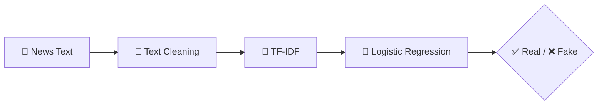

<div align="center">


<b><i>Spot fake news with NLP & Machine Learning — Django</i></b>


       

   
</div>

---

## 📰 About the Project

Based on the paper *“Detecting Fake News Using Machine Learning Algorithms”*, this **Django** web app classifies news articles as **REAL or FAKE** using **NLP (TF-IDF)** and **Logistic Regression** among other algorithms. Users submit news text; admins review model results and manage users.

## ✨ Key Features

- 📝 Paste any news text and get an instant **Real / Fake** verdict
- 🧹 NLP pipeline — cleaning, stop-word removal, **TF-IDF** vectorisation
- 📊 Algorithm comparison & accuracy **results page** for admins
- 👥 User registration with **admin activation**
- 📄 Abstract, base paper and full code included

## 🧠 How It Works



## 🛠️ Tech Stack

| Layer | Technology |
|---|---|
| Backend | Django (Python) |
| NLP / ML | NLTK · scikit-learn (TF-IDF, Logistic Regression) |
| Database | SQLite |
| Frontend | HTML5 · CSS3 · JavaScript |

## 📂 Project Structure

```text
29 Detecting Fake News/
├── ABSTRACT/     # project abstract
├── BASEPAPER/    # reference paper
└── CODE/fakenews/
    ├── admins/   # admin app
    ├── users/    # user app (prediction)
    ├── assets/   # templates + static
    └── manage.py
```

## 🚀 Getting Started

```bash
git clone https://github.com/PreciousBharath/FAKE-NEWS-DETECTION.git
cd "FAKE-NEWS-DETECTION/29 Detecting Fake News/CODE/fakenews"
pip install django pandas scikit-learn nltk
python manage.py migrate
python manage.py runserver
```

## 🤝 Contributing

Contributions, issues and feature requests are welcome! Feel free to ⭐ star the repo and open a pull request.

## 👨‍💻 Author

<div align="center">

**Bharath** — Software Developer · Project Engineer · Technical Trainer

<a href="https://github.com/PreciousBharath"></a>
<a href="https://linkedin.com/in/connectbharath"></a>

### 🍔 EAT · 😴 SLEEP · 💻 CODE · 🔁 REPEAT

⭐ **If you found this project useful, give it a star!** ⭐


</div>
